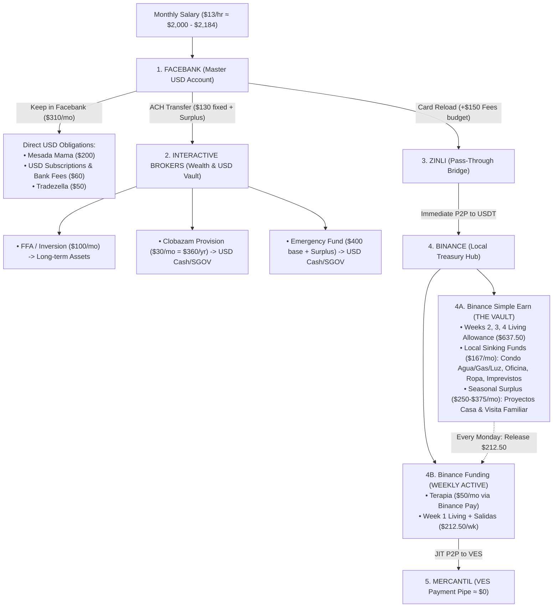

# Personal Finance & Psychology System

> **Core Philosophy:** Combining **T. Harv Eker's *Secrets of the Millionaire Mind*** (structured multi-account habits, the 6 Jars balance, and reprogramming your money blueprint: `P → T → F → A = R`) with **Morgan Housel's *The Psychology of Money*** (Room for Error, Reasonable > Rational, separating survival reserves from risk, and recognizing that life happens in seasons rather than static spreadsheet lines).

---

## 1. Psychological Foundations (From `sources/`)

### A. T. Harv Eker — *Secrets of the Millionaire Mind*
1. **The Habit Beats the Amount (Wealth File #14):** You don't wait until you have "extra money" to manage it; managing the money you have now creates the container for more wealth.
2. **Holistic Balance (The 6 Jars):**
   - If you only save and pay bills (**Necessities**), your spirit rebels and sabotages your budget through impulse spending. You *must* have a guilt-free **Play** allocation (`Salidas`) to strengthen your "receiving muscle."
   - Your **Financial Freedom Account (`Inversion` in IBKR)** is your "Golden Goose"—principal is **never spent**, only invested to build passive income.
3. **Observing the Blueprint (`P → T → F → A = R`):**
   - Past Programming (`P`) → Thoughts (`T`) → Feelings (`F`) → Actions (`A`) = Results (`R`).
   - When an expense spikes or anxiety hits, use this journal to **observe** the trigger without guilt or blame (Wealth File #1).

### B. Morgan Housel — *The Psychology of Money*
1. **Reasonable > Rational:** A financial system you can actually follow in real life beats a mathematically "perfect" spreadsheet that collapses the first time routine breaks.
2. **Room for Error (Margin of Safety):**
   - A budget that assumes $2,457/mo of outflows on a ~$2,000–$2,184/mo income has **negative Room for Error**.
   - By sizing **Core Living + Sinking Funds to $1,657/mo**, you create **~$343–$527/mo of natural Room for Error (Dynamic Surplus)** at `$13/hr`.
3. **Life Happens in Seasons ("Regimes"):**
   - Not every month is a "Routine Month." House repairs (Oct 2026) or family visits (Grandma for 3 months + Cousin & GF for 1 month in Nov–Jan) are **Out-of-Routine Seasons**.
   - Instead of treating seasonal spikes as "budget failures," we explicitly switch how the **Dynamic Surplus** is routed during those months.

---

## 2. The Arbitrage & 5-Account Funnel Architecture

### Why the Funnel Exists (`Facebank → Zinli → Binance → Mercantil`)
- **Official BCV Rate:** `~881.07 VES/USD`
- **Binance P2P Rate:** `~1,002.80 VES/USDT` (~13.8% gross spread)
- **Funnel Cost (`Fees` = $150/mo):** Reloading Zinli from Facebank + P2P spread costs ~6–7%, leaving a **~7% net purchasing-power gain** whenever paying Venezuelan merchants who charge in VES at the official BCV rate.
- **Golden Rule of Rails:**
  1. **Never store money in `Mercantil` (VES):** Immediate devaluation risk. Keep resting balance near **$0**.
  2. **Avoid swiping `Zinli` at Venezuelan POS:** Local POS charges BCV rate in USD, forfeiting the ~13.8% P2P spread after you already paid the Zinli load fee. Use `Zinli` strictly as the **USD → USDT bridge** to Binance.
  3. **Never send USD to Binance unless it will be spent locally in VES/USDT:** Any money meant to stay in USD (`Emergency Fund`, `Inversion`, `Clobazam` bought in Peru via Western Union) goes `Facebank → IBKR` via ACH to avoid the ~6% bridge fee.

---

## 3. Master Allocation Table (All 39 Categories)

Your 39 categories from `Monthly Overview` are preserved intact so your Telegram bot (`Code.js`) continues to work without changes. They are grouped into **4 operational layers**:

### Layer 1: Facebank Direct USD & Funnel Friction ($460/mo)
| Category (`Monthly Overview`) | Monthly $ | Eker Jar | Payment Rail & Rule |
| :--- | ---: | :--- | :--- |
| `Mesada mama` | $200 | GIVE | Facebank direct transfer |
| `Subscripciones Tradezella` | $50 | EDUC | Facebank card (USD) |
| `Subscripciones Google` | $20 | NEC | Facebank card (USD) |
| `Subscripciones ACH` | $15 | NEC | Facebank ACH fee |
| `Subscripciones Seguro` | $10 | NEC | Facebank card (USD) |
| `Subscripciones Spotify` | $8 | NEC | Facebank card (USD) |
| `Subscripciones Facebank` | $6 | NEC | Facebank maintenance fee |
| `Subscripciones Zinli` | $1 | NEC | Zinli maintenance fee |
| `Fees` | $150 | NEC | COGS of `Facebank → Zinli → Binance` arbitrage funnel |
| **Subtotal Layer 1** | **$460** | | **Stays in / spent from Facebank** |

### Layer 2: Interactive Brokers Fixed Transfers ($130/mo + Emergency Surplus)
| Category (`Monthly Overview`) | Monthly $ | Eker Jar | Payment Rail & Rule |
| :--- | ---: | :--- | :--- |
| `Inversion` | $100 | FFA | ACH to IBKR → Invested in long-term risk assets (never spent) |
| `Medicinas Clobazam` | $30 | NEC (Sinking) | ACH to IBKR → Accumulates to **$360/yr** in Cash/`SGOV` for annual Peru Western Union purchase |
| **Subtotal Layer 2 (Fixed)** | **$130** | | **Direct ACH `Facebank → IBKR` (saves ~6% bridge fee)** |

### Layer 3: True Monthly Local Living (`Binance Funding → Mercantil / Binance Pay`) ($900/mo)
*Released in **4 weekly tranches of $212.50 USDT** from `Binance Earn` to `Binance Funding` (plus $50 `Terapia` via Binance Pay).*

| Category (`Monthly Overview`) | Monthly $ | Weekly $ | Eker Jar | Payment Rail & Notes |
| :--- | ---: | ---: | :--- | :--- |
| `Mercado Rio` | $300 | $75.00 | NEC | Binance P2P → Mercantil (BCV rate) |
| `Mercado Reponer` | $50 | $12.50 | NEC | Binance P2P → Mercantil |
| `Agua potable` | $15 | $3.75 | NEC | Binance P2P → Mercantil |
| `Medicinas Lamotrigina` | $60 | $15.00 | NEC | Binance P2P → Mercantil |
| `Medicinas Levetiracetam` | $60 | $15.00 | NEC | Binance P2P → Mercantil |
| `Medicinas Mama` | $20 | $5.00 | GIVE | Binance P2P → Mercantil |
| `Medico` | $50 | $12.50 | NEC | Binance P2P → Mercantil |
| `Terapia` | $50 | *(Direct)* | NEC/EDUC | **Binance Pay (USDT)** directly |
| `Subscripciones Internet` | $50 | $12.50 | NEC | Binance P2P → Mercantil |
| `Subscripciones Joel` | $20 | $5.00 | NEC | Binance P2P → Mercantil |
| `Condominio Apartamentos` | $20 | $5.00 | NEC | Binance P2P → Mercantil |
| `Subscripciones Movistar` | $10 | $2.50 | NEC | Binance P2P → Mercantil |
| `Condominio Deuda` | $0 | $0.00 | NEC | Inactive ($0) |
| `Condominio Aseo` | $0 | $0.00 | NEC | Inactive ($0) |
| `Transporte` | $80 | $20.00 | NEC | Binance P2P → Mercantil |
| `Barberia` | $15 | $3.75 | NEC | Binance P2P → Mercantil |
| `Comunidad Iglesia` | $40 | $10.00 | GIVE | Binance P2P → Mercantil |
| `Comunidad NA` | $20 | $5.00 | GIVE | Binance P2P → Mercantil |
| `Comunidad Running` | $0 | $0.00 | PLAY | Inactive ($0) |
| `Salidas` | $40 | $10.00 | PLAY | Binance P2P → Mercantil (Guilt-free Play) |
| **Subtotal Layer 3** | **$900** | **$212.50/wk** *(+$50 Terapia)* | | **Active monthly local flow** |

### Layer 4: Local Sinking Funds in `Binance Simple Earn (Vault)` ($167/mo)
*These do **not** get spent every month. They sit in `Binance Simple Earn` and accumulate across months until their batch/irregular expense occurs.*

| Category (`Monthly Overview`) | Monthly $ | Eker Jar | Sinking Fund Rule |
| :--- | ---: | :--- | :--- |
| `Condominio Agua` | $10 | NEC (Sinking) | Accumulates in Binance Earn for **annual fee ($120/yr)** |
| `Condominio Gas` | $5 | NEC (Sinking) | Accumulates in Binance Earn until **multi-month gas tank refill** |
| `Condominio Luz` | $2 | NEC (Sinking) | Accumulates in Binance Earn for **multi-month batch payment** |
| `oficina` | $50 | EDUC/Work | Accumulates in Binance Earn for laptop/tech/workspace needs |
| `ropa` | $50 | PLAY/LTSS | Accumulates in Binance Earn for periodic clothing purchases |
| `Imprevistos` | $50 | LTSS/Buffer | **48-Hour Local Emergency Buffer** in Binance Earn (instant USDT liquidity) |
| **Subtotal Layer 4** | **$167** | | **Locked in `Binance Simple Earn` until needed** |

---

## 4. Dynamic Surplus Layer (`Fondo de emergencia` + `Proyectos casa`)

- **Core Total (Layers 1 + 2 + 3 + 4):** **`$460 + $130 + $900 + $167 = $1,657 / month`**
- **Your Monthly Surplus (`Salary - $1,657`):**
  - At **$2,000/mo** (154h): **+$343/mo**
  - At **$2,080/mo** (160h): **+$423/mo**
  - At **$2,184/mo** (168h): **+$527/mo**

### Seasonal Routing Rules for Your Surplus
| Season / Period | IBKR (`Fondo de emergencia`) | Binance Earn (`Proyectos casa` / Seasonal Vault) | Purpose |
| :--- | :--- | :--- | :--- |
| **Nov 2026 – Jan 2027** *(Family Visit Season)* | **~30% (~$100–$150/mo)** *(Grows $400 base → ~$750)* | **~70% (~$250–$375/mo)** | Covers Grandma (3m) + Cousin & GF (1m) extra food, salidas, transport & utilities without touching core buckets |
| **Feb 2027 Onward** *(Routine + CapEx Sprint)* | **~30–50% (~$150–$200/mo)** | **~50–70% (~$250–$350/mo)** | Accelerated savings sprint for **Washing Machine + Dryer + Installation** & house projects |

---

## 5. Monthly Payday & Weekly Monday Checklist

### Once a Month (Payday in `Facebank`)
1. **Check Total Paycheck (`S`)** in Facebank.
2. **Leave `$310` in Facebank** for `Mesada mama` ($200) + USD subscriptions/fees ($110). *(Plus ~$150 for the Zinli/Facebank reload fees as you bridge).*
3. **Send ACH to `IBKR`:**
   - `$100` (`Inversion` → buy assets)
   - `$30` (`Clobazam` → park in Cash/`SGOV`)
   - `+$100 to $150` (`Fondo de emergencia` share of surplus → park in Cash/`SGOV`, adding to your $400 base).
4. **Bridge the Rest (`$1,067` Core Local + `~$250–$375` Seasonal Surplus) via `Zinli → Binance P2P`:**
   - Immediately move **`$804.50` + Seasonal Surplus** into **`Binance Simple Earn (Flexible)`** (this locks away Weeks 2–4 of living + `$167` Sinking Funds + Seasonal Surplus).
   - Leave **`$262.50` USDT** in **`Binance Funding`** (`$212.50` for Week 1 living + `$50` for `Terapia` via Binance Pay).

### Every Monday Morning (2-Minute Ritual)
1. Open Binance → Redeem **`$212.50 USDT`** from `Simple Earn` to `Funding Wallet`.
2. During the week, convert `Funding` USDT → `Mercantil` VES via P2P only as needed to pay for groceries, transport, medicines, and salidas.
3. If a **Sinking Fund** or **Seasonal event** occurs (e.g., `Proyectos casa`, `Ropa`, `Oficina`, or `Visita Familiar` extra groceries), transfer that exact amount from `Simple Earn` and log the context in [`journal/`](file:///home/ubuntu/personal/finances/journal/).
